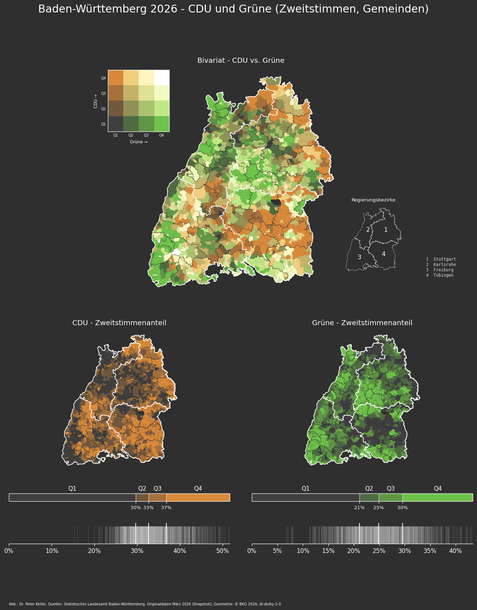
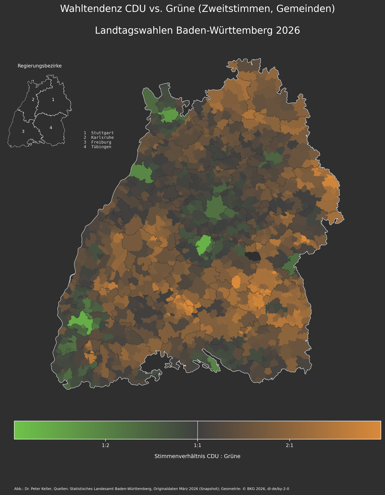
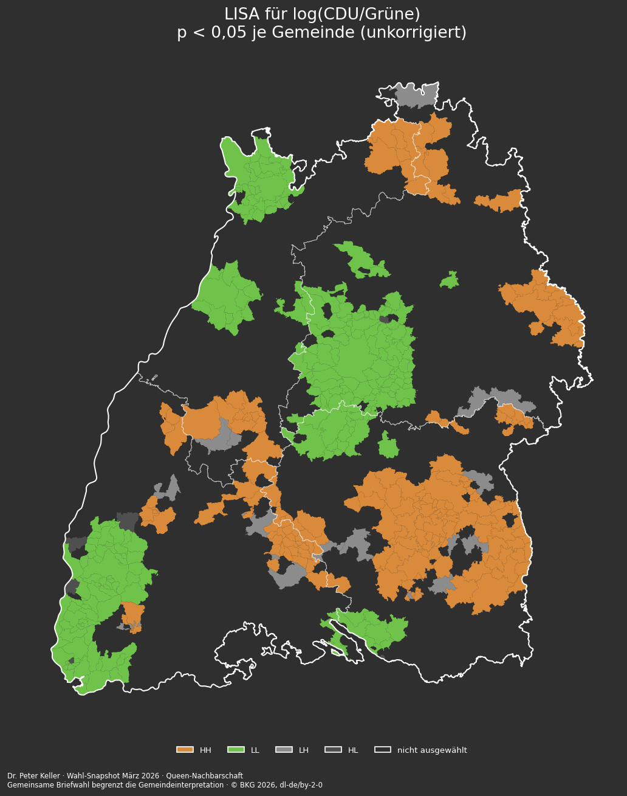

# Landtagswahlen – räumliche Exploration

Wie verändert sich der Blick auf ein Wahlergebnis, wenn man zwischen Parteianteilen, Stimmenverhältnissen und räumlicher Nachbarschaft wechselt? Dieses Projekt geht dieser Frage anhand der Landtagswahl Baden-Württemberg 2026 nach. Die unterschiedlichen Darstellungen bleiben nebeneinander sichtbar – einschließlich ihrer Grenzen und der Korrekturen, die sich bei der Aufbereitung ergeben haben.

Die ausführliche Analyse steht in [BadenWuerttemberg.ipynb](BadenWuerttemberg.ipynb).

**Stand:** Historischer Wahl-Snapshot aus dem ursprünglichen Projekt, kein aktueller Ergebnisdienst. Details stehen in den [Quellen und Datenständen](docs/QUELLEN.md).

## Verschiedene Fragen, verschiedene Karten



Die bivariate Karte zeigt relativ hohe und niedrige Anteile beider Parteien. Sie beantwortet eine andere Frage als das Stimmenverhältnis: CDU und Grüne können beide in einem hohen Quartil liegen, obwohl eine der beiden deutlich vorne liegt.



Das logarithmierte Verhältnis stellt den Vorsprung in den Mittelpunkt. Die kategorisierte Variante im Notebook macht daraus direkt lesbare Verhältnisbereiche. Die Erst-/Zweitstimmenkarten ergänzen beide Ansätze um Barcodes der Gemeindeverteilung.

Der [Ternärplot](figures/ternaer.png) zeigt Grüne, CDU und die übrigen Parteien mit einheitlichen Gemeindepunkten. Die [Gewinnerkarte](figures/staerkste_partei.png) zeigt die stärkste Partei je Gemeinde.



Moran und LISA untersuchen zusätzlich die Nachbarschaft. Die Analyse vergleicht das rohe und das logarithmierte Verhältnis sowie lokale und für Mehrfachtests korrigierte Schwellen. Die Karten sind explorative Hinweise, keine Erklärung individuellen Wahlverhaltens.

Der [Vergleich der Ansätze](docs/ANSAETZE.md) dokumentiert, welche Information jede Darstellung betont, welche sie ausblendet und was gegenüber dem ursprünglichen Notebook korrigiert wurde. Die dunklen Hintergründe, Farbpaletten, Barcodes und Kartenlayouts sind Bestandteil der ursprünglichen Gestaltung von Dr. Peter Keller.

## Ausführen

Python 3.11 oder neuer. Im Projektordner:

```powershell
python -m venv .venv
.venv\Scripts\python -m pip install -r requirements.txt
.venv\Scripts\python run_notebooks.py
```

Unter Linux/macOS lautet der Python-Pfad `.venv/bin/python`. Der Runner führt das Notebook in einem frischen Kernel aus und speichert die Ausgaben. Neue Abbildungen und Prüftabellen landen in `outputs/`, das nicht versioniert wird. Die README enthält eine kleine Auswahl unter `figures/`.

Zum interaktiven Erkunden:

```powershell
.venv\Scripts\python -m jupyterlab
```

Die Eingaben liegen als kleine, dokumentierte Ausschnitte in `data/`. Es werden keine Nachbarordner oder computerspezifischen Pfade benötigt. Seed und Permutationszahl stehen am Anfang des BW-Notebooks. Für eine einzelne Ausführung kann der Notebookname übergeben werden:

```powershell
.venv\Scripts\python run_notebooks.py BadenWuerttemberg.ipynb
```

## Was geprüft wird

- Keine doppelte Summierung von Wahlbezirk, Gemeinde und Wahlkreis.
- Parteistimmen gegen gültige Stimmen; Landes-, Wahlkreis- und Wahlbezirkssummen gegeneinander.
- Eindeutige Gemeindeschlüssel und vollständige Geometriezuordnung.
- Fehlende Werte, Gleichstände, Quartile und die BH-Korrektur.

```powershell
python -m unittest discover -s tests -v
```

Die Unterschiede der Datenstände und gemeinsame Briefwahlbezirke werden nicht durch technische Prüfungen beseitigt. Sie bleiben Teil der Interpretation.

## Dateien und Rechte

Das Notebook enthält den sichtbaren Analyseweg. `election_tools.py` bündelt ausschließlich die wiederverwendete Datenaufbereitung und Prüfungen. `docs/` dokumentiert Entscheidungen und Quellen; `data/manifest.json` hält Eingabeprüfsummen fest.

Quellcode und eigene Dokumentation: [MIT-Lizenz](LICENSE), © 2026 Peter Keller. Die zugrunde liegenden amtlichen Daten unterliegen den jeweiligen [Quellenbedingungen](docs/QUELLEN.md). Die Karten sind eigene Bearbeitungen und keine amtlichen Wahlkarten.
